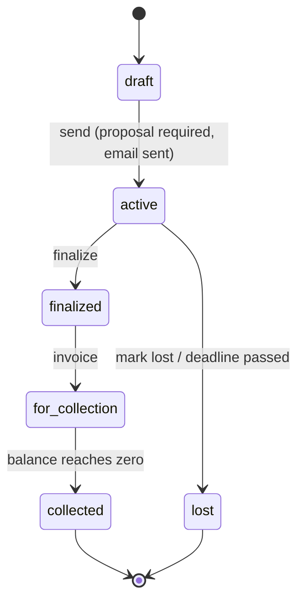

# Software Requirements Specification

## Tender Management System

| | |
|---|---|
| **Document ID** | TMS-SRS-001 |
| **Version** | 1.4 |
| **Status** | Baseline |
| **Date** | 2026-10-08 |
| **Format** | Based on ISO/IEC/IEEE 29148:2018 |

### Revision history

| Version | Date | Description |
|---|---|---|
| 0.1 | 2026-10-08 | Initial draft consolidated from the business brief and the product review findings. |
| 1.0 | 2026-10-08 | First baseline. |
| 1.1 | 2026-10-08 | Quantified ambiguous requirements; split compound requirements; added reliability, performance, compliance, localization and verification; added source traceability; corrected invoiced-amount constraint. |
| 1.2 | 2026-10-08 | Resolved all pending decisions: USD currency, provider-standard logout, session storage and login rate limiting, soft deletion, editable budget and deadline in draft, no proposal replacement when active, admin-only restrictions confirmed. |
| 1.3 | 2026-10-08 | Closed all remaining open points: send-failure semantics, documentation access, immediate rejection of disabled accounts, whole-number quantities, inactive and duplicate products, archived-entity behaviour, pagination contract, invoiced-amount and payment fields, concrete configuration values, test reproducibility, English as the product language. |
| 1.4 | 2026-10-08 | Specification review: client attributes, password policy, archive as the single user disable mechanism with provider ban, self-archive and last-admin race protection, invoice correction, row locking for all tender mutations, proposal object cleanup, reminder suppression, input limits and uniqueness, email content and time format, dashboard window parameter, session-end behaviour, backups and error logging, narrower audit claim, new exclusions. |

### Document conventions

- Requirement IDs are stable and never reused: `FR-` functional, `BR-` business rule, `SEC-` security, `DAT-` data, `NFR-` other non-functional, `UI-` user interface.
- **Priority** uses MoSCoW: *Must* (release-blocking), *Should* (expected, may be deferred with justification).
- **Verification** method: *T* = automated test, *I* = inspection (code/config review), *D* = demonstration.
- "Shall" denotes a mandatory requirement.
- Lifecycle states appear by their system identifier in `code font`.
- Tickets, tests and commits shall cite the requirement IDs they implement or verify.
- Implementation status is intentionally **not** tracked here. It lives in the issue tracker.

---

## 1. Introduction

### 1.1 Purpose

This document specifies the software requirements of the Tender Management System (TMS) for developers, testers and the product owner.

### 1.2 Scope

This document covers TMS release 1.0, the complete product. The TMS lets a company draft, submit, track, resolve and collect payment on commercial tenders addressed to its clients. A tender is drafted, a formal proposal document is attached, and it is formally sent to the client with an automatic email notification. It is monitored until its deadline with automatic reminders, resolved as won or lost, and, if won, invoiced and collected until the balance is settled. Every status change, payment, archive and restore is attributable to a user and a timestamp.

The product comprises:

- A REST API with OpenAPI documentation.
- A single-page web application consuming that API.
- Scheduled background processing (expiry and reminders).

Out of scope is listed in section 6.

### 1.3 Definitions, acronyms and abbreviations

| Term | Definition |
|---|---|
| Tender | A commercial offer addressed to a client, with products, a maximum budget, a deadline and a proposal document. |
| Client | The organisation to which tenders are addressed. Receives emails, does not log in. |
| Product | A catalogue item with a list price. |
| Tender line | The link between a tender and a product, with quantity and a unit price frozen when the line is added. |
| Proposal | The formal PDF document attached to a tender. |
| Maximum budget | The ceiling for the sum of a tender's lines. |
| Invoiced amount | The total to be collected from the client once the tender enters `for_collection`. |
| Outstanding balance | Invoiced amount minus the sum of registered payments. |
| Transition history | The immutable log of every tender status change. |
| Scheduled job | A periodic process with no human user (null actor) that performs expiry and reminders. |
| RLS | Row Level Security (PostgreSQL). |
| JWT | JSON Web Token. |
| SPA | Single-page application. |

### 1.4 References

| ID | Document |
|---|---|
| REF-1 | Business brief: "Tender Management System" (functional scope, states, rules). |
| REF-2 | Quality review findings, numbered 1 to 22 (security, data integrity and UX defects consolidated into this SRS). |
| REF-3 | `README.md`: setup and design decisions. |

### 1.5 Document overview

Section 2 describes the product in context. Section 3 holds the specific, verifiable requirements. Sections 4 and 5 cover the data model and lifecycle. Section 6 lists exclusions. Appendix A is the traceability matrix; Appendix B the verification approach.

---

## 2. Overall description

### 2.1 Product perspective

The TMS is a self-contained web product. It depends on four external services:

| External system | Role |
|---|---|
| PostgreSQL (hosted Supabase) | System of record and user authentication. |
| Object storage (Cloudflare R2) | Private storage of proposal documents. |
| Transactional email (Resend) | Delivery of client emails with attachments. |
| Cron scheduler (Cloudflare Cron Triggers) | Triggers expiry and reminder processing. |

### 2.2 Product functions (summary)

1. Authenticate users and enforce role-based access.
2. Manage clients, products and users.
3. Draft tenders with products under a budget ceiling.
4. Attach a proposal document and send the tender to the client by email.
5. Enforce the tender lifecycle and record every transition.
6. Automatically expire overdue tenders and remind clients before the deadline.
7. Invoice won tenders, register payments and close collection automatically.
8. Provide a dashboard of tenders nearing their deadline.
9. Provide audited, documented, paginated access to all of the above.

### 2.3 User classes and characteristics

| Role | Description |
|---|---|
| `admin` | Manages users and the product catalogue; invoices, registers payments and marks tenders lost. Can do everything `user` can. |
| `user` | Operates the tender lifecycle: clients, tenders, tender products, proposal, sending, finalising. |
| `viewer` | Read-only access. Every non-read request is rejected. |
| System | The scheduled job. Records transitions with a null actor. |
| Client (external) | No account. Only receives emails. |

### 2.4 Operating environment

- Server: Cloudflare Workers runtime with Node.js compatibility.
- Database: PostgreSQL 17. A local Docker-based instance is used for development and automated tests.
- Clients: current evergreen desktop and mobile browsers.

### 2.5 Design and implementation constraints

- **C-1** PostgreSQL is the system of record; the Worker connects through a pooled connection binding, never a direct database URL, at runtime.
- **C-2** Email and file storage integrations shall be real (no simulated providers) in the deployed environment.
- **C-3** The scheduled job shall run in the deployed environment, not only locally.
- **C-4** No secrets in version-controlled configuration.
- **C-5** The API shall be described by OpenAPI.

### 2.6 Assumptions and dependencies

- **A-1** Real-world monetary amounts are rarely round numbers. Design and tests shall use awkward values (for example 333.33 + 666.67).
- **A-2** The system uses a single currency, United States dollar (USD), for all monetary values.
- **A-3** Tenders are created in `draft`, which is an explicit persisted state that precedes sending.
- **A-4** Availability of the four external services in section 2.1.

---

## 3. Specific requirements

### 3.1 External interface requirements

#### 3.1.1 User interface

The SPA is the primary human interface. It is served by the same origin as the API. Specific behaviour is specified in section 3.2.9.

#### 3.1.2 Hardware interfaces

Not applicable. The TMS has no direct hardware interfaces.

#### 3.1.3 Software interfaces

| ID | Interface | Requirement | Priority | Verif. |
|---|---|---|---|---|
| IF-01 | REST API | All functionality is exposed under `/api/*`, JSON in and out, with OpenAPI documentation. | Must | I |
| IF-02 | Supabase Auth | JWTs are verified against the provider's published signing keys. | Must | T |
| IF-03 | Object storage | Proposals are stored in a private bucket and served only through an authenticated endpoint. | Must | T |
| IF-04 | Email provider | Emails are sent with the proposal as an attachment. | Must | D |
| IF-05 | Cron scheduler | Invokes the scheduled handler at a fixed interval. | Must | D |

#### 3.1.4 Error contract

Errors are returned with a stable code, a human-readable message and the correct HTTP status:

| HTTP | Code | Used for |
|---|---|---|
| 400 | `VALIDATION_ERROR` | Invalid input; includes the failing field. |
| 401 | `UNAUTHENTICATED` | Missing or invalid session. |
| 403 | `FORBIDDEN` | Authenticated but role not permitted. |
| 404 | `NOT_FOUND` | Unknown resource. |
| 409 | `CONFLICT` | State conflict. |
| 422 | `BUSINESS_RULE_VIOLATION`, `TENDER_BUDGET_EXCEEDED`, `INVALID_TENDER_TRANSITION` | Business rule violations. |
| 429 | `RATE_LIMITED` | Too many attempts. |
| 500 | `INTERNAL_ERROR` | Unexpected failure. |
| 502 | `EMAIL_DELIVERY_FAILED` | The email provider rejected or failed to deliver a requested send. |

### 3.2 Functional requirements

#### 3.2.1 Authentication and user management

| ID | Requirement | Priority | Verif. |
|---|---|---|---|
| FR-01 | The system shall authenticate users with email and password and issue a JWT-based session. | Must | T |
| FR-02 | Logging out shall terminate the user's session at the authentication provider, revoking its refresh tokens (provider sign-out, default `global` scope), and the client shall discard its stored session. | Must | T |
| SEC-17 | An access token issued before logout remains valid until its `exp` claim, as in the provider's standard behaviour. The access-token lifetime shall be set explicitly to 3600 seconds (1 hour) in the authentication provider configuration and documented, and this residual window is an accepted risk. SEC-19 closes the window for archived accounts. | Must | I |
| FR-03 | Only `admin` users shall be able to create other users. The admin sets the user's initial password (SEC-20); no one can change it afterwards. | Must | T |
| FR-04 | The system shall restrict listing users to `admin`. | Must | T |
| FR-33 | The system shall restrict editing users (role) to `admin`. Archiving is the only way to disable a user. | Must | T |
| FR-05 | The system shall prevent the last non-archived `admin` from being demoted or archived, so at least one admin always exists. The check shall run in a transaction that locks the rows of all non-archived admins, so concurrent requests cannot both pass it. | Must | T || FR-40 | An `admin` shall be able to archive (soft-delete) and restore a user, a client or a tender. Archiving shall set an archive marker and shall not remove data, history or payments. | Must | T |
| FR-40 | An `admin` shall be able to archive (soft-delete) and restore a user, a client or a tender. Archiving shall set an archive marker and shall not remove data, history or payments. | Must | T |
| FR-41 | Archived users, clients and tenders shall be excluded from default lists. List endpoints shall accept `archived=only` or `archived=include`, honoured for `admin` only; for any other role the parameter is ignored and archived records are never returned. | Must | T |
| FR-42 | An archived user shall not be able to log in. An archived client shall not be selectable for new tenders; the existing tenders of an archived client are kept unchanged. | Must | T |
| FR-47 | An archived tender shall be read-only: every operation that would modify it, other than restoring it, shall be rejected with `409` `CONFLICT`. | Must | T |
| FR-48 | Archiving a client that has tenders in `draft`, `active`, `finalized` or `for_collection` shall be rejected with `409` `CONFLICT`. | Must | T |
| FR-51 | Archiving a user shall, in the same operation, mark the profile as archived, ban the user at the authentication provider and revoke the user's refresh tokens. Restoring the user shall lift the ban and keep the user's previous role. | Must | T |
| FR-52 | An `admin` shall not be able to archive themselves or change their own role; the request is rejected with `409` `CONFLICT` and another admin must perform it. | Must | T |
| FR-53 | Restoring an archived tender whose client is archived shall be allowed. The client remains archived and unusable for new tenders. | Must | T |
| FR-44 | A tender shall be archivable only while `draft`, `collected` or `lost`. Archiving or restoring shall not change its status or write to the transition history as a status change. | Must | T |
| FR-06 | Login attempts shall be rate-limited by the authentication provider's configurable rate limits, set to at most 10 sign-in attempts per 5 minutes per IP address. The Worker shall forward the end user's IP address so limits apply per end user rather than per Worker, and shall map a provider `429` to `429` with code `RATE_LIMITED`. | Must | T |

#### 3.2.2 Clients

| ID | Requirement | Priority | Verif. |
|---|---|---|---|
| FR-07 | The system shall allow creating a client with a contact name, a company name and a contact email, all required. | Must | T |
| FR-36 | The system shall allow listing clients, paginated. | Must | T |
| FR-37 | The system shall allow editing a client's contact name, company name and contact email. | Must | T |

#### 3.2.3 Products

| ID | Requirement | Priority | Verif. |
|---|---|---|---|
| FR-08 | The system shall allow an `admin` to create a product. | Must | T |
| FR-38 | The system shall allow listing products, paginated. | Must | T |
| FR-39 | The system shall allow an `admin` to edit a product, including its active flag. Products are deactivated, not archived. | Must | T |
| FR-46 | The system shall reject adding an inactive product to a tender with `422` `BUSINESS_RULE_VIOLATION`. Existing lines of a product that is later deactivated are kept. | Must | T |
| FR-09 | A product's list price shall be strictly positive. | Must | T |

#### 3.2.4 Tenders

| ID | Requirement | Priority | Verif. |
|---|---|---|---|
| FR-10 | The system shall create a tender in `draft` with client, title, description, maximum budget and deadline. | Must | T |
| FR-11 | The system shall list tenders, paginated, filterable by status. | Must | T |
| FR-12 | The tender detail shall return general data, products, status history and payments. | Must | T |
| FR-13 | Editing a tender shall change only title and description, except budget and deadline while `draft` (FR-43). Client and status shall not be modifiable through the edit operation. | Must | T |
| FR-43 | While a tender is `draft`, the system shall allow changing its maximum budget and deadline. The new budget shall not be lower than the current sum of the tender's lines (BR-01) and the new deadline shall be in the future (BR-02). | Must | T |
| FR-14 | Adding or removing a product shall be allowed only in `draft` and `active`. The unit price shall be frozen on the line when added; later catalogue price changes shall not alter existing lines. Changes made while `active` are not notified to the client, whose emailed copy may therefore be outdated. | Must | T |
| FR-15 | The system shall allow uploading the proposal (PDF) to private storage while the tender is `draft`. | Must | T |
| FR-34 | The system shall reject uploading or replacing the proposal in `finalized`, `for_collection`, `collected` and `lost`. | Must | T |
| FR-35 | The system shall reject uploading or replacing the proposal while the tender is `active`, because the client has already received the previous file by email. | Must | T |
| FR-54 | When a proposal is replaced while the tender is `draft`, the previously stored object shall be deleted from object storage after the new one is stored. If the deletion fails, the replacement still succeeds and the failure is logged. The proposal of an archived tender is kept. | Must | T |
| FR-16 | The stored proposal shall be retrievable through a real, stable HTTPS URL of the system, and that URL shall require a valid session. | Must | T |
| FR-17 | Sending a tender shall, in this order, validate that a proposal is attached (BR-03) and that the deadline is in the future (BR-15), send the client email, and only then transition `draft` to `active`. | Must | T |
| FR-18 | Users with role `user` or `admin` shall be able to mark an `active` tender `finalized`. | Must | T |
| FR-19 | An `admin` shall be able to mark an `active` tender `lost`. | Must | T |
| FR-20 | An `admin` shall be able to invoice a `finalized` tender by recording the invoiced amount, transitioning it to `for_collection`. | Must | T |
| FR-50 | An `admin` shall be able to correct the invoiced amount of a `for_collection` tender while it has no registered payments. The new amount shall be strictly greater than zero (BR-16). The correction does not change the status and is attributed through the modifier and timestamp (DAT-06). | Must | T |
| FR-21 | The system shall expose a tender's transition history. | Must | T |

#### 3.2.5 Payments

| ID | Requirement | Priority | Verif. |
|---|---|---|---|
| FR-22 | An `admin` shall be able to register a payment only when the tender is `for_collection`. A payment has a required amount, an optional reference and an optional note; its timestamp is assigned by the server. | Must | T |
| FR-23 | The system shall list a tender's payments together with its outstanding balance. | Must | T |
| FR-24 | When the outstanding balance reaches zero, the tender shall automatically transition to `collected`. | Must | T |

#### 3.2.6 Email

| ID | Requirement | Priority | Verif. |
|---|---|---|---|
| FR-25 | On sending, the client shall receive a real email summarising the tender (products, budget, deadline) with the proposal attached. | Must | D |
| FR-26 | While a tender is `active` and fewer than 48 hours remain to its deadline, the client shall receive one reminder email stating the title, the deadline and the hours remaining, without attachment. If fewer than 48 hours already remained when the tender was sent, no reminder is sent. | Must | T |
| FR-27 | Every user-supplied value interpolated into email HTML (title, file name, names) shall be HTML-escaped. | Must | T |

#### 3.2.7 Scheduled processing

| ID | Requirement | Priority | Verif. |
|---|---|---|---|
| FR-28 | When the deadline passes and the tender is still `active`, the scheduled job shall transition it to `lost` with a null actor. | Must | T |
| FR-29 | The 48-hour reminder (FR-26) shall be issued by the same scheduled mechanism. Sending a tender with fewer than 48 hours remaining shall mark its reminder as already sent at that moment. | Must | T |
| FR-30 | Scheduled processing shall be idempotent: overlapping or repeated runs shall not duplicate emails or transitions. | Must | T |

#### 3.2.8 Dashboard and API documentation

| ID | Requirement | Priority | Verif. |
|---|---|---|---|
| FR-31 | The dashboard shall show `active` tenders whose deadline falls within a window set by the `withinHours` query parameter (integer 1 to 720, default 72; a value outside the range is rejected with `VALIDATION_ERROR`), and a count of tenders per status. Both exclude archived tenders. | Should | T |
| FR-32 | The system shall present the OpenAPI documentation as an interactive Swagger UI page at the SPA route `/docs`, reachable only by signed-in users of any role. The page shall load the OpenAPI document with the user's session token, and "Try it out" requests shall use that same token. | Must | D |
| FR-45 | A request to `/openapi.json` without a valid session shall be rejected with `401`. The API shall not serve interactive documentation pages at `/api/docs` or `/redocs`: a request to either never returns a documentation page. | Must | T |

#### 3.2.9 User interface behaviour

| ID | Requirement | Priority | Verif. |
|---|---|---|---|
| UI-01 | Whenever the server rejects an operation, the UI shall show the server's message to the user as a visible notice, including inline edits and list actions. | Must | D |
| UI-02 | Validation errors shall be shown against the field that failed. | Should | D |
| UI-03 | Controls restricted to `admin` shall not be shown to other roles; write controls shall not be shown to `viewer`. | Must | D |
| UI-04 | At a viewport width of 360 px, every column of the tender list (including deadline and status) shall be reachable by horizontal scrolling or an adaptive layout, with no clipped content. | Must | D |
| UI-05 | Confirmations shall use an in-app accessible dialog, not the browser's native dialog. | Should | D |
| UI-06 | Red shall be reserved for destructive actions. Neutral actions such as "Edit" shall use a neutral style. | Should | I |
| UI-07 | Every page shall have a top-level heading. | Should | I |
| UI-08 | Inline-edit fields shall have an associated label and shall submit with Enter. | Should | D |
| UI-09 | All forms shall be operable by keyboard alone. | Should | D |
| UI-10 | On any `401` response the SPA shall discard the local session, return to the login screen with the message "Your session has ended" and not keep showing previously loaded data. | Must | D |

### 3.3 Business rules

| ID | Rule | Priority | Verif. |
|---|---|---|---|
| BR-01 | The system shall reject adding a product line when the sum of the tender's line totals would exceed its maximum budget, and the API shall return an error. | Must | T |
| BR-02 | The system shall require every tender to have a deadline, and shall reject a deadline that is not in the future, both through the API and in the form. | Must | T |
| BR-03 | The system shall send a tender only if it has a proposal document stored in object storage. | Must | T |
| BR-04 | A proposal shall be a valid PDF: its content shall begin with the `%PDF-` signature, regardless of the client-declared type. | Must | T |
| BR-13 | A proposal larger than 15 MB shall be rejected. | Must | T |
| BR-05 | The system shall compute the outstanding balance as the invoiced amount minus the sum of registered payments. | Must | T |
| BR-11 | The system shall reject a payment whose amount is not strictly greater than zero. | Must | T |
| BR-12 | The system shall reject a payment whose amount exceeds the outstanding balance. | Must | T |
| BR-06 | Money shall be handled as integer minor units (cents) or exact decimal end to end. Floating-point values shall never be compared with strict equality. | Must | T |
| BR-07 | Every status transition shall be recorded in the history (actor, timestamp, previous status, new status) in the same operation that changes the status. | Must | T |
| BR-08 | Only the transitions in section 5.2 are permitted. Any other shall be rejected with an error. | Must | T |
| BR-09 | Every operation that modifies a tender (lines, budget, deadline, proposal, sending, finalizing, marking lost, invoicing, invoice correction, payments, archiving) shall run in a transaction that row-locks the tender, to prevent races between concurrent requests and the scheduled job. Concurrency tests shall cover at least BR-01 (budget against lines) and sending (against line changes). | Must | T |
| BR-10 | The system shall allow a tender's maximum budget and deadline to change only while it is `draft`, and shall not allow its client to change after creation. | Must | T |
| BR-14 | A product shall appear at most once per tender. Adding it again shall be rejected with `409` `CONFLICT`; to change the quantity the line is removed and added again. | Must | T |
| BR-15 | Sending a tender whose deadline is not in the future shall be rejected with `422` `BUSINESS_RULE_VIOLATION`. A `draft` tender never expires automatically. | Must | T |
| BR-16 | The invoiced amount shall be any value strictly greater than zero. It is not capped by the maximum budget or by the sum of the tender's lines. | Must | T |
| BR-17 | A line quantity shall be a whole number greater than or equal to 1. | Must | T |

### 3.4 Role permissions

`Y` permitted, `N` rejected with `403`. `viewer` may only perform read operations. The matrix shall be enforced at route registration.

| Resource | Operation | `admin` | `user` | `viewer` |
|---|---|---|---|---|
| Auth | login, logout, current user | Y | Y | Y |
| Users | list, create, edit | Y | N | N |
| Users | archive, restore | Y | N | N |
| Clients | list | Y | Y | Y |
| Clients | create, edit | Y | Y | N |
| Clients | archive, restore | Y | N | N |
| Products | list | Y | Y | Y |
| Products | create, edit | Y | N | N |
| Tenders | list, detail, history, list payments, download proposal | Y | Y | Y |
| Tenders | create, edit, add/remove product, upload proposal, send, finalize | Y | Y | N |
| Tenders | archive, restore | Y | N | N |
| Tenders | mark lost | Y | N | N |
| Tenders | invoice, correct invoiced amount | Y | N | N |
| Payments | register | Y | N | N |
| Dashboard | view | Y | Y | Y |
| API documentation | view | Y | Y | Y |

Requests without a valid session receive `401` on every route except login.

Archived records are listed only for `admin` (FR-41).

Restricting product management, invoicing, payment registration and marking a tender lost to `admin` goes beyond the business brief, which only restricts user creation to administrators. It is a confirmed product decision.

| ID | Requirement | Priority | Verif. |
|---|---|---|---|
| SEC-01 | The permission matrix above shall be enforced server-side on every endpoint; each cell is covered by an automated test. | Must | T |

### 3.5 Data requirements

| ID | Requirement | Priority | Verif. |
|---|---|---|---|
| DAT-01 | The tender status shall be a database enumerated type, not free text. | Must | I |
| DAT-02 | The database shall enforce a `CHECK` constraint that a tender's maximum budget is strictly greater than zero. | Must | T |
| DAT-07 | A tender line's quantity shall be stored as an integer, and the database shall enforce a `CHECK` constraint that it is greater than or equal to 1 (BR-17). | Must | T |
| DAT-08 | The database shall enforce a `CHECK` constraint that a tender line's frozen unit price is strictly greater than zero. | Must | T |
| DAT-09 | The database shall enforce a `CHECK` constraint that a tender's invoiced amount, when set, is strictly greater than zero. A zero invoiced amount would make the outstanding balance zero from the start and the tender could never reach `collected`. | Must | T |
| DAT-10 | The database shall enforce a `CHECK` constraint that a payment amount is strictly greater than zero. | Must | T |
| DAT-11 | Users, clients and tenders shall have a nullable archive timestamp and the archiving user. Restoring clears them; the restoring user is recorded as the last modifier (DAT-06). | Must | I |
| DAT-12 | Text inputs shall be limited to these maximum lengths, enforced by the API and the database: tender title 200, tender description 5,000, client contact name 200, company name 200, product name 200, payment reference 100, payment note 500, email address 254. A violation is rejected with `VALIDATION_ERROR`. | Must | T |
| DAT-13 | Every monetary input shall be between 0.01 and 9,999,999,999.99, consistent with `numeric(12,2)`. A violation is rejected with `VALIDATION_ERROR`. | Must | T |
| DAT-14 | A product name shall be unique, ignoring letter case. A duplicate is rejected with `409` `CONFLICT`. Client names and emails are not unique. | Must | T |
| DAT-15 | A user's email shall be unique. A duplicate is rejected with `409` `CONFLICT`. | Must | T |
| DAT-03 | The database shall have indexes on tender status, on deadline, and on frequently joined foreign keys. | Should | I |
| DAT-04 | Monetary columns shall use `numeric(12,2)`. | Must | I |
| DAT-05 | Critical integrity rules shall not depend only on application code: a script or future endpoint bypassing the domain layer shall not be able to put the database in an impossible state. | Must | T |
| DAT-06 | Every entity shall record who created and last modified it, and when. | Must | T |

### 3.6 Security requirements

| ID | Requirement | Priority | Verif. |
|---|---|---|---|
| SEC-02 | JWTs shall be verified cryptographically. If verification cannot be completed, access is denied (fail closed). | Must | T |
| SEC-03 | RLS shall be enabled on every public table, with no policies granting access to `anon` or `authenticated`: data is reached only through the Worker. | Must | T |
| SEC-12 | Table privileges on application tables shall be revoked from the `anon` and `authenticated` database roles. | Must | T |
| SEC-13 | The provider's auto-generated data API shall not expose the application schema, or any new table created in it. | Must | I |
| SEC-14 | A request to the provider's data API using the public project key shall not be able to read or write any application table. | Must | T |
| SEC-04 | The API documentation shall not be publicly readable (FR-32, FR-45). | Must | T |
| SEC-05 | The configured provider rate-limit values, the access-token lifetime and the password policy (FR-06, SEC-17, SEC-20) shall be recorded in the deployment documentation. | Must | I |
| SEC-19 | On every authenticated request, the system shall reject, with `401` `UNAUTHENTICATED`, a user whose profile is archived, even if the presented access token is still valid. | Must | T |
| SEC-20 | Passwords shall have a minimum length of 12 characters, configured at the authentication provider. No composition rules are imposed. | Must | I |
| SEC-06 | Object storage shall be private; the bucket shall have no public access. | Must | I |
| SEC-15 | Object names shall contain a random identifier of at least 122 bits (for example UUID v4) and shall not be derived from tender data. | Must | I |
| SEC-16 | A download request without a valid session shall return `401`. | Must | T |
| SEC-07 | Secrets shall never reach the client, be logged, or be committed. The Supabase secret key is used server-side only. | Must | I |
| SEC-08 | The SPA shall keep the provider session in the browser storage used by the provider's client library for single-page applications (`localStorage`) and shall be served with a Content Security Policy that forbids third-party scripts and inline script execution. | Must | I |
| SEC-18 | The SPA shall render server-supplied text only through escaped output; it shall not inject raw HTML from API data. | Must | I |
| SEC-09 | All database access shall use parameterised queries. | Must | I |
| SEC-10 | Validation failures shall never be reported as `FORBIDDEN` or "Unauthorized". | Must | T |
| SEC-11 | Uploaded files shall be validated per BR-04 and BR-13 before being stored. | Must | T |

### 3.7 Quality attributes

| ID | Requirement | Priority | Verif. |
|---|---|---|---|
| NFR-01 | Integration tests shall run in the real Workers runtime against a real local database. | Must | I |
| NFR-23 | The automated tests shall cover the full tender lifecycle, every valid transition and every invalid transition. | Must | I |
| NFR-02 | Tests shall use realistic amounts and dates. Mandatory case: invoice 1,000.00, pay 333.33 then 666.67, and the tender ends `collected`. | Must | T |
| NFR-03 | Every `BR-` rule has at least one automated test. | Must | I |
| NFR-04 | TypeScript strict mode shall be enabled in both backend and SPA, and the SPA linter shall be installed and executed. | Should | I |
| NFR-05 | The code base shall compile without warnings and without `any`. Errors are centralised in a typed taxonomy. | Should | I |
| NFR-06 | Every list endpoint shall be paginated through the query parameters `page` (from 1) and `pageSize` (default 20, maximum 100), and shall respond with `{ data, page, pageSize, total }`. A `pageSize` above the maximum shall be rejected with `VALIDATION_ERROR`. Default order is creation time, newest first. The only filters are `status` on tenders (FR-11) and `archived` (FR-41). | Must | T |
| NFR-07 | The system shall be deployed at a public URL with private storage, real email, API documentation and a scheduled job running in the deployed environment. | Must | D |
| NFR-08 | The repository shall include a README with installation and run instructions and the key design decisions. | Must | I |
| NFR-09 | Version-control history shall consist of atomic commits (one logical change each) whose messages explain why. | Should | I |
| NFR-10 | The deployed environment shall have recorded evidence that a real email with the proposal attached was received by a client address (provider log or capture). | Must | D |
| NFR-11 | The deployed environment shall have recorded evidence that a stored proposal is retrievable through its real URL. | Must | D |
| NFR-12 | The deployed environment shall have recorded evidence that the scheduled job has fired on its own (for example a system-actor transition at the scheduled time). | Must | D |
| NFR-26 | The provider's automatic daily database backups shall be enabled and their retention policy recorded in the deployment documentation. | Should | I |
| NFR-27 | Unexpected errors shall be logged with a correlation identifier that is also returned to the caller, and the logs shall contain no personal data or secrets. | Should | I |
| NFR-24 | The automated test suite shall be runnable with a single documented command against a local database, and the continuous-integration pipeline shall start that database and run the suite on every push and pull request. | Must | I |

#### 3.7.1 Performance

| ID | Requirement | Priority | Verif. |
|---|---|---|---|
| NFR-13 | For lists of up to 10,000 tenders, a paginated list request shall respond in under 500 ms at the 95th percentile, excluding network latency. | Should | T |
| NFR-14 | Registering a payment shall complete in under 1 s at the 95th percentile, including the row lock. | Should | T |

#### 3.7.2 Reliability and availability

| ID | Requirement | Priority | Verif. |
|---|---|---|---|
| NFR-15 | The scheduled job shall run at least once per hour. A tender past its deadline shall therefore be moved to `lost`, and a due reminder sent, within 60 minutes of the condition becoming true. | Must | T |
| NFR-16 | If the email fails when sending a tender (FR-17), the tender shall remain in `draft`, no history entry shall be written, and the API shall respond `502` `EMAIL_DELIVERY_FAILED` so the operation can be retried. If the email is delivered but the transition then fails, a retry may deliver a duplicate email; this is an accepted risk. | Must | T |
| NFR-17 | If an email send fails in the scheduled job, the reminder marker shall not be set, so the next run retries. | Must | T |
| NFR-18 | The system should target 99.5% monthly availability of the API, bounded by the availability of the external services in section 2.1. | Should | I |

#### 3.7.3 Compliance and data protection

| ID | Requirement | Priority | Verif. |
|---|---|---|---|
| NFR-19 | Personal data (user and client contact emails) shall be exposed only to authenticated users permitted by section 3.4, and shall not appear in logs. | Must | T |
| NFR-20 | Passwords shall never be stored or logged by the application; credential handling is delegated to the authentication provider. | Must | I |

#### 3.7.4 Localization

| ID | Requirement | Priority | Verif. |
|---|---|---|---|
| NFR-21 | Timestamps shall be stored in UTC and rendered in the user's local time zone. | Must | T |
| NFR-22 | Monetary values shall be stored and displayed in USD with two decimals. | Must | D |
| NFR-25 | The product language is English: every user-interface text, API message, client email and OpenAPI description shall be in English. | Must | D |
| NFR-28 | Emails shall state dates in UTC with the zone explicit (for example `2026-10-15 17:00 UTC`) and monetary values in USD with two decimals. They shall be sent from the configured sender address with no Reply-To header. | Must | T |

---

## 4. Data model

### 4.1 Entities

| Entity | Attributes |
|---|---|
| Client | contact name, company name, contact email, archive marker |
| Profile (user) | email, role, archive marker |
| Product | name, list price, active |
| Tender | title, description, client, maximum budget, deadline, status, proposal key and URL, invoiced amount, reminder-sent marker, archive marker |
| Tender line | tender, product, quantity (whole number), frozen unit price |
| Payment | tender, amount, reference, note, registering user, timestamp |
| Status history entry | tender, previous status, new status, actor (null for the system), timestamp |

### 4.2 Relationships

- A Client has many Tenders; a Tender belongs to exactly one Client.
- A Tender has many Products (many-to-many through Tender line, with quantity and price).
- A Tender has one attached proposal document (a reference to the stored file).
- A Tender has many Payments, registered only while `for_collection`.
- Every status change creates one Status history entry.

---

## 5. Tender lifecycle

### 5.1 States

| State | Meaning |
|---|---|
| `draft` | Being prepared. Persisted state before sending. It never expires automatically (BR-15). |
| `active` | Sent to the client; awaiting resolution before the deadline. |
| `finalized` | Won and delivered. |
| `for_collection` | Invoiced; payments pending. |
| `collected` | Fully paid. Terminal. |
| `lost` | Not won, or expired. Terminal. |

### 5.2 Permitted transitions

| From | To | Condition |
|---|---|---|
| `draft` | `active` | Proposal attached and deadline in the future. The client email is sent first; if it fails the tender stays `draft` (NFR-16). |
| `active` | `finalized` | The company won and completed delivery. |
| `active` | `lost` | Manually (not won) or automatically (deadline passed unresolved). |
| `finalized` | `for_collection` | Invoiced; collection pending. |
| `for_collection` | `collected` | Automatic, when the outstanding balance reaches zero. |

Any other combination is rejected with an error (BR-08). In `finalized`, `for_collection`, `collected` and `lost`, products cannot be added or removed (FR-14).

---

## 6. Exclusions

- Multi-currency, taxes and discounts.
- A client-facing portal (clients only receive emails).
- Multi-step approval workflows.
- Physical (hard) deletion of users, clients and tenders. Soft deletion is specified in FR-40..44.
- Notification channels other than email.
- Integration with external electronic invoicing.
- Changing or recovering a password after the account is created, by anyone. The admin sets the initial password when creating the user (FR-03).
- Voiding or reversing a registered payment.
- A general audit log of every mutation; auditing is limited to what section 1.2 states.
- Handling of client replies to emails; emails are sent without Reply-To (NFR-28).
- A formal accessibility conformance target such as WCAG 2.2 AA; UI-07 to UI-09 apply.

---

## Appendix A. Requirement traceability

Maps each business capability to its requirements and to the source it originates from (REF-1 = business brief, REF-2 = product review findings, by finding number; "Design" = a decision taken during specification). Verification evidence lives in the automated test suite and in the issue tracker (see Appendix B).

| Capability | Requirements | Source |
|---|---|---|
| Authentication and roles | FR-01..06, FR-33, FR-40..42, FR-44, FR-47, FR-48, FR-51..53, DAT-11, DAT-15, SEC-01, SEC-02, SEC-05, SEC-10, SEC-17, SEC-19, SEC-20 | REF-1; REF-2 #2, #8, #9, #10, #17, #21 |
| Catalogue and clients | FR-07..09, FR-36..39, FR-46, DAT-12..14 | REF-1; Design |
| Tender drafting and budget | FR-10..14, FR-43, BR-01, BR-02, BR-10, BR-14, BR-17 | REF-1; REF-2 #12 |
| Proposal and sending | FR-15, FR-16, FR-17, FR-25, FR-34, FR-35, FR-54, BR-03, BR-15, BR-04, BR-13, SEC-06, SEC-11, SEC-15, SEC-16 | REF-1; REF-2 #11, #13 |
| Lifecycle and audit | FR-18..21, BR-07, BR-08, DAT-06 | REF-1 |
| Collection | FR-22..24, FR-50, BR-05, BR-06, BR-09, BR-11, BR-12, BR-16, DAT-13, NFR-02 | REF-1; REF-2 #1 |
| Scheduled processing | FR-26, FR-28..30, NFR-15, NFR-17 | REF-1 |
| Email safety | FR-27, NFR-16 | REF-2 #16 |
| Data integrity | DAT-01..05, DAT-07..10 | REF-2 #4 |
| Database exposure | SEC-03, SEC-12..14 | REF-2 #5 |
| API surface | FR-32, FR-45, IF-01..05, SEC-04, NFR-06 | REF-1; REF-2 #7, #15 |
| User interface and accessibility | UI-01..10, FR-31 | REF-1; REF-2 #3, #6, #19, #20 |
| Browser-side security | SEC-08, SEC-18 | REF-2 #14, #16 |
| Secrets and query safety | SEC-07, SEC-09 | Design |
| Quality and delivery | NFR-01, NFR-03..05, NFR-07..12, NFR-23, NFR-24 | REF-1; REF-2 #18, #22 |
| Performance, reliability, compliance, localization | NFR-13, NFR-14, NFR-18..22, NFR-25..28 | Design |
| Role restrictions beyond user creation | Section 3.4 | Design |

## Appendix B. Verification

Every requirement carries a verification method in its table row.

| Method | Meaning | Evidence |
|---|---|---|
| T (test) | Automated integration test in the real Workers runtime against a real local database. | Test name cites the requirement ID. |
| I (inspection) | Review of code, schema, migrations or configuration. | Reference in the ticket that closes the requirement. |
| D (demonstration) | Manual run in the deployed environment or browser. | Recorded in the ticket: capture, provider log or screenshot. |

Acceptance rule: a requirement is closed only when its verification evidence exists. A ticket that implements a requirement shall cite its ID, and the corresponding test (or evidence) shall cite the same ID.
